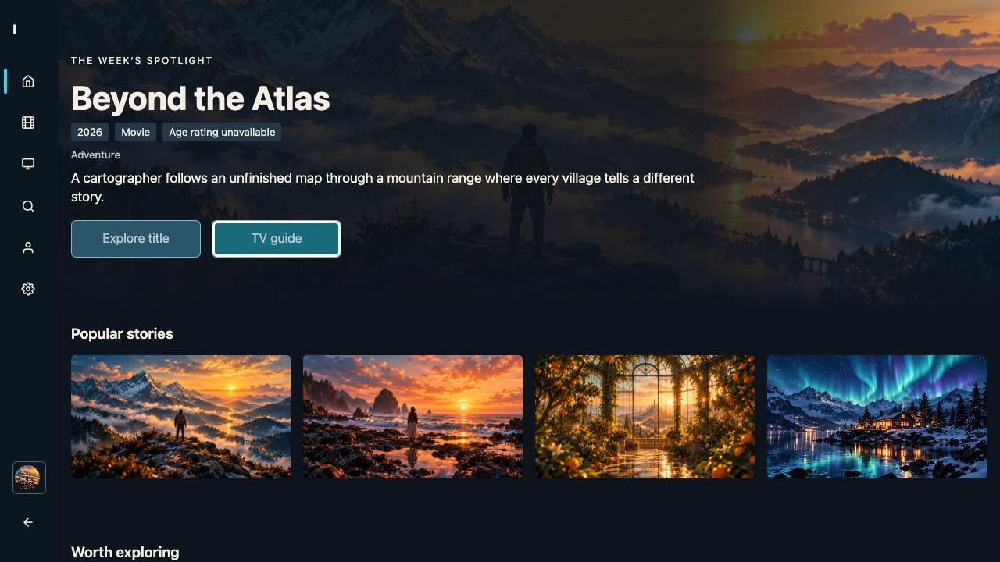

<div dir="rtl" lang="ar">

# إطار · Itar

**العربية** · [English](README.md)

[المزايا](#features) · [تتبّع التأشير باستخدام Occo](#occo) · [البدء](#start) · [مثال React](#example) · [حالة الأجهزة](#devices) · [مقارنة المكتبات](#comparison) · [أدلة المشروع](#guides)

إطار محرّك مكتوب بلغة C++20 لإدارة التأشير (focus) في تطبيقات التلفاز المبنية باستخدام React Native. عندما تتنقّل بين بطاقات الأفلام بجهاز التحكّم، ينقل السهم التأشير من بطاقة إلى أخرى، ويفتح زرّ الاختيار الفيلم المؤشَّر إليه.

تخيّل أنك فتحت فيلماً من الصف الرابع في واجهة البث، ثم ضغطت زر الرجوع بعد أن تغيّرت محتويات القائمة. إذا ظهر الفيلم نفسه أيضاً في صفّ التوصيات، فمعرفة معرّف الفيلم وحده لا تكفي. يتيح إطار للتطبيق تذكّر البطاقة التي فتحتها، وطلب إظهارها مجدداً، ومعرفة ما إذا كان التأشير قد عاد إليها فعلاً.

**النسخة التجريبية متاحة من الشيفرة المصدرية، والاختبار على أجهزة التلفاز الفعلية مستمر.** يمكنك بناء المحرّك وتشغيل التطبيق النموذجي وتجربة المكتبة في تطبيقك. ما زالت الواجهة البرمجية وسلوك المنصّات قابلين للتغيير. تضمّ الحزمة في إصدارها `0.1.0-beta` موائم التطبيقات الأصلية `itar/react` وموائم الويب `itar/web` الذي يشغّل محرّك WebAssembly على Samsung Tizen وLG webOS، وتُثبَّت من نسخة محلية للمستودع أو من حزمة تبنيها بنفسك. [حالة الأجهزة والفحوص المتبقية](docs/ar/devices/README.md)

[](docs/images/itar-cinema-preview.mp4)

*تطبيق Itar Cinema يعرض الفهرس التجريبي المرفق بالشيفرة.* [شاهد العرض (دقيقة وسبع ثوانٍ، MP4).](docs/images/itar-cinema-preview.mp4)

<a name="features"></a>

## ماذا يقدّم إطار؟

- **القوائم والصفوف والشاشات.** حدّد لكل منطقة قابلة للتنقّل نطاقاً، واختر ترتيباً أفقياً أو رأسياً أو مكانياً. يمكنك تحديد سلوك الأسهم عند الحافة، والعنصر الذي يبدأ منه التنقّل، ومتى يُستعاد آخر موضع للتأشير.
- **بطاقات لها هدف تأشير واحد.** ضع الصورة والعنوان داخل مكوّن `Focusable` واحد. يحمل العنصر الخارجي التسمية التي يقرأها قارئ الشاشة، ويتولّى التفعيل وإظهار التأشير. ويمكن إعطاء كل ظهور للفيلم نفسه مفتاحاً مستقلاً.
- **قوائم افتراضية.** يتتبّع المحرّك العناصر المنطقية في القوائم والصفوف ذات الأبعاد الثابتة، بينما يعرض React مجموعة محدودة من البطاقات. عند طلب بطاقة بعيدة، يستطيع المحرّك انتظار إنشاء عنصرها والتمرير إليه وتأكيد المنصّة انتقال التأشير.
- **واجهات يجري تحميلها أو تبديلها.** يمكنك تأجيل دخول التأشير إلى نطاق حتى تصبح بياناته جاهزة، وإلغاء الطلبات التي فقدت غرضها، ومعرفة نتيجتها. يتتبّع إطار تأشير الإدخال وتأشير إمكانية الوصول كلّاً على حدة؛ ويتولّى قارئ الشاشة الاستكشاف والنطق.

<a name="occo"></a>

## تتبّع التأشير باستخدام Occo

Occo أداة لتشخيص مشكلات التأشير، يمكنك تفعيلها في نسخة التطوير من Itar Cinema على Android TV وApple TV وفي متصفّح Chrome. يعرض السجلّ الأحداث بترتيبها الزمني، فتستطيع معرفة أيّ ضغطة من جهاز التحكّم وصلت إلى التطبيق، وأيّ بطاقة طلب إطار نقل التأشير إليها، وكيف استجاب التلفاز، وأين استقرّ كلّ من تأشير الإدخال وتأشير قارئ الشاشة. في Chrome، يتاح رصد تأشير الإدخال في الصفحة فقط.

لنفترض أنّك ضغطت السهم لأسفل لتنتقل إلى البطاقة التالية، لكنّ قارئ الشاشة انتقل إلى القائمة الجانبية. هل طلب إطار التأشير إلى القائمة؟ في التسجيل التجريبي المرفق، طلب إطار البطاقة التالية. وافق التلفاز على الطلب، ثم أُلغي الطلب، ومع ذلك وصل تأشير الإدخال إلى البطاقة. بعد ذلك انتقل تأشير قارئ الشاشة إلى القائمة. يساعدك ترتيب هذه الأحداث على تحديد أين تتابع البحث عن السبب.

- **جرّب الأداة من دون تلفاز.** افتح عارض التسجيلات في متصفّحك من نسخة المستودع على حاسوبك، ثم اختر ملفّ التسجيل التجريبي بصيغة JSON. اختر الحدث رقم 13 لترى البطاقة التي تلقّت تأشير الإدخال والقائمة التي انتقل إليها قارئ الشاشة. [عارض التسجيلات المحلي](apps/probe/occo/viewer.html) · [التسجيل التجريبي](apps/probe/occo/synthetic-example.json)
- **سجّل ما يحدث على جهازك.** اختر **Start Occo recording** من إعدادات Cinema، ثم كرّر الحركة التي تريد فحصها. اختر **Freeze and inspect Occo recording** لتجميد السجلّ وتصفّح أحداثه. يمكنك تصدير التسجيل ليفحصه مطوّر آخر على حاسوبه دون اتصال بالإنترنت. [دليل Android TV](docs/ar/devices/android-tv.md#تسجيل-حركة-التأشير-بأداة-occo) · [دليل Apple TV](docs/ar/devices/apple-tv.md#تسجيل-التنقّل-والاختيار-باستخدام-occo) · [دليل Chrome](docs/ar/devices/web-tv.md#occo-chrome)

<a name="start"></a>

## البدء من نسخة المستودع

### تشغيل اختبارات المحرّك

تحتاج إلى CMake بالإصدار 3.20 أو أحدث وإلى مصرّف يدعم C++20. نفّذ الأوامر التالية من جذر المستودع. لا يتطلّب هذا المسار Node.js أو حزمة تطوير للتلفاز أو جهازاً فعلياً.

<div dir="ltr">

```sh
cmake -S core -B build/core -DCMAKE_BUILD_TYPE=Release -DBUILD_TESTING=ON
cmake --build build/core --parallel 2
ctest --test-dir build/core --output-on-failure --no-tests=error --timeout 60
```

</div>

### تجربة Itar Cinema في المتصفح

يتيح لك التطبيق تصفّح صفوف الأفلام والبحث وفتح صفحات التفاصيل والمشغّل باستخدام لوحة المفاتيح كجهاز تحكّم. تستعمل نسخة الويب React Native Web وعناصر DOM، وتُشغّل المحرّك نفسه بعد بنائه بصيغة WebAssembly.

1. استخدم Node.js بالإصدار **22.23.4** وnpm بالإصدار **10.9.9**. إذا كنت تستخدم nvm، فنفّذ `nvm use`.
2. ثبّت تبعيات المشروع وابنِ حزمة TypeScript بالأمرين أدناه.
3. ثبّت **Emscripten 6.0.13** وفعّله وفق [دليل المتصفح وتلفزيونات الويب](docs/ar/devices/web-tv.md). ستحتاج أيضاً إلى CMake وPython 3.10 أو أحدث.
4. نفّذ `npm run web` ثم افتح `http://127.0.0.1:8080`. اختر **Sign in**، وأرسل النموذج التجريبي، ثم اختر ملفاً شخصياً. تبدأ الجلسة الجديدة بفهرس الأفلام المرفق. تنقّل بالأسهم، وافتح بطاقة بمفتاح Enter، ثم اضغط Escape للعودة إلى الصف. يمكنك أيضاً استخدام Tab والمؤشّر.

<div dir="ltr">

```sh
npm ci --ignore-scripts --no-audit
npm run build
```

</div>

لتجربة سلوك المنصّة الأصلي، شغّل التطبيق على [Android TV أو Fire TV](docs/ar/devices/android-tv.md) أو [Apple TV](docs/ar/devices/apple-tv.md). يشرح [دليل Cinema](docs/ar/ott-app.md) محتوى العرض والشاشات المخصّصة للمطوّرين، ويعرض مسارات عملية لاختبار التنقّل.

<a name="example"></a>

## إضافة قائمة مشاهدة إلى شاشة React Native TV

يرتبط التطبيق النموذجي بحزمة `itar` المحلية تلقائياً. إذا أردت استخدامها في تطبيق آخر، فاتبع [دليل الدمج](docs/ar/guides/integration.md) لبناء ملف الحزمة وإعداد التبعيات الأصلية. استورد مكوّنات React من `itar/react`.

<div dir="ltr">

```tsx
import {FocusProvider, FocusScope, Focusable, occurrenceKey} from 'itar/react';

const entries = [
  {id: 'arrival', title: 'Arrival'},
  {id: 'solaris', title: 'Solaris'},
];

export function Watchlist({openTitle}: {openTitle: (id: string) => void}) {
  return (
    <FocusProvider style={{flex: 1}}>
      <FocusScope id="watchlist" layout="row" style={{flexDirection: 'row'}}>
        {entries.map((entry, index) => (
          <Focusable
            key={entry.id}
            occurrenceKey={occurrenceKey('watchlist', entry.id)}
            contentId={entry.id}
            accessibilityLabel={entry.title}
            order={index}
            style={{width: 200, height: 80}}
            focusStyle={{accentColor: '#26d9f2'}}
            onPress={() => openTitle(entry.id)}
          />
        ))}
      </FocusScope>
    </FocusProvider>
  );
}
```

</div>

يحدّد المفتاح `occurrenceKey('watchlist', 'arrival')` بطاقة الفيلم داخل قائمة المشاهدة. إذا ظهر الفيلم في صف التوصيات أيضاً، يحصل ظهوره هناك على مفتاح مختلف، فيستطيع التطبيق العودة إلى الموضع الصحيح. تحدّد الخاصية `layout="row"` سياسة التنقّل. أمّا `flexDirection` وأبعاد العناصر فتحدّد تخطيط الواجهة في React Native. [بناء القوائم والصفوف وتخصيص البطاقات](docs/ar/guides/collections.md)

<a name="devices"></a>

## حالة النسخة التجريبية على الأجهزة

| المنصّة | ما أمكن تجربته | ما يزال بحاجة إلى اختبار |
| --- | --- | --- |
| Android TV وGoogle TV | اختُبر إطار سينما على Chromecast HD مع تفعيل TalkBack وتعطيله. وشملت اختبارات محاكي Google TV التنقّل بالأسهم واستعادة التأشير عند الرجوع مع TalkBack في حالات محدّدة. | إعادة اختبار النزول بين الصفوف وتحميل المحتوى على Chromecast بالنسخة الأحدث. |
| Apple TV وtvOS | اجتاز إطار سينما الاختبار على جهاز Apple TV HD مع تفعيل VoiceOver وتعطيله، بما في ذلك التنقّل بجهاز التحكّم واستعادة التأشير عند الرجوع من شاشات متداخلة واستخدام أزرار المشغّل. | إعادة الاختبار على طرز أخرى من Apple TV وإصدارات أخرى من tvOS. |
| Fire TV بنظام Fire OS | اجتاز إطار سينما الاختبار على جهاز Fire TV فعلي (الطراز AFTKA، ومستوى Android API 28) مع تفعيل VoiceView وتعطيله. شمل الاختبار صفوف الرئيسية والتوصيات، والرجوع إلى البطاقة التي فُتحت منها التفاصيل، والتقديم والترجيع في المشغّل. | اختبار طرز وإصدارات أخرى من Fire OS. ويتطلّب Vega OS موائمًا مستقلًا. |
| متصفحات الحاسوب وSamsung Tizen وLG webOS | نجح اختبار التنقّل في سينما على تلفاز Samsung مع Voice Guide وعلى تلفاز LG مع Audio Guidance. يستخدم Chromium موائم DOM/Wasm نفسه. | اختبار طرازات أخرى وإصدارات مختلفة من المتصفّح. |
| منصّات أخرى | لا يتوافر في النسخة الحالية محوّل تشغيلي لمنصّات Vega OS وVIDAA وXbox وPlayStation. | تحديد مسار الدمج واختباره على الأجهزة المعنيّة. Roku خارج نطاق المشروع. |

<a name="comparison"></a>

## كيف يقارن إطار بأنظمة التأشير الأخرى؟

إذا كان تطبيقك يستخدم Norigin، يمكنك مواصلة تعريف كلّ بطاقة بمفتاح ثابت. يضيف إطار طلبًا تستطيع إلغاءه أثناء تمرير الصفّ أو الانتقال إلى شاشة أخرى، ونتيجةً تخبرك بما إذا كانت المنصّة قد نقلت التأشير إلى البطاقة المقصودة فعلًا. يستخدم Cinema مفاتيح الظهور نفسها على Android TV وApple TV والويب. يتاح موائم المتصفّح من خلال `itar/web` ويستهدف Chrome 85.

تتتبّع المقارنة ما يحدث في صفّ واحد عند إعادة ترتيبه والرجوع إليه من شاشة التفاصيل. وتبيّن كيف يختار كلّ من إطار ونظام التأشير المدمج في React Native TV ومكتبتَي Norigin وBAM البطاقة التالية، وما تعيده أوامر التأشير، وحدود القوائم الافتراضية في كلّ نظام، وكيف يتعامل مع قارئ الشاشة. [مقارنة أنظمة إدارة التأشير على التلفاز](docs/ar/comparison.md)

<a name="guides"></a>

## أين أجد التفاصيل؟

| ما تريد فعله | نقطة البداية |
| --- | --- |
| دمج شاشة أو مراجعة خصائص المكوّنات | [دليل الدمج](docs/ar/guides/integration.md) · [مرجع واجهة React](packages/itar/README.ar.md) |
| تتبّع ضغطة زر من جهاز التحكّم إلى عنصر الواجهة | [دليل البنية](docs/ar/guides/architecture.md) |
| اختبار جهاز أو الإبلاغ عن مشكلة | [أدلة الأجهزة](docs/ar/devices/README.md) · [دليل المساهمة](CONTRIBUTING.ar.md) |
| استكشاف الشيفرة | [نواة C++](core/README.ar.md) · [الحزمة وطبقات المنصّات](packages/itar/) · [التطبيق النموذجي](apps/probe/) |
| العثور على دليل أو أمر بناء أو طريقة اختبار | [فهرس التوثيق العربي](docs/ar/README.md) |

يُوزَّع إطار وفق [رخصة MIT](LICENSE). وللتطبيق النموذجي [أيقونات موثّقة المصدر](apps/probe/ott/assets/cinematic/icons/README.ar.md) و[فيلم تجريبي له اعتماد مستقل](docs/ar/ott-app.md).

</div>
