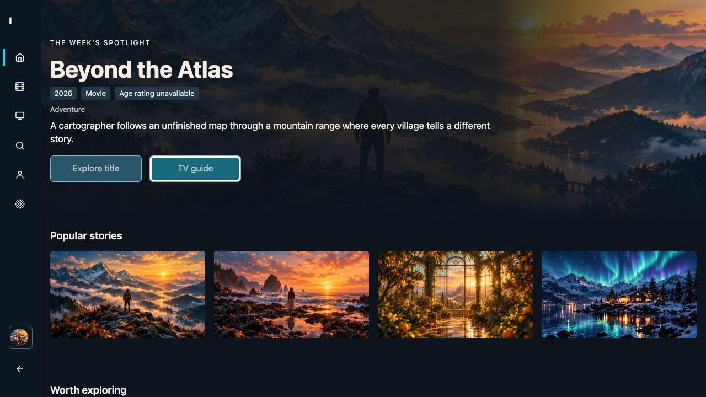

# Itar · إطار

**English** · [العربية](README.ar.md)

[Features](#what-you-can-build-with-it) · [Get started](#try-it-from-a-checkout) · [React example](#use-it-in-a-react-native-tv-screen) · [Devices](#where-the-beta-stands) · [Compare libraries](#how-itar-compares) · [Documentation](#find-your-way-around)

Itar is a C++20 focus engine for React Native TV apps. It handles the part of remote navigation that gets difficult in a real catalogue. A viewer can open a movie from the fourth rail, watch something, and press Back after the list has changed. Itar gives the app a way to identify that *particular card*, ask the host to reveal it, and learn whether focus actually returned.

**Source beta · physical-device testing in progress.** The React API and host behavior can change. You can build the engine, run the example and try a local package in a TV app. The workspace and package are marked private at version `0.0.0`. Install the beta from this checkout or build a local tarball. [Device status and open checks](docs/devices/README.md)



*Itar Cinema, the example app, running with the bundled catalogue.*

## What you can build with it

- **Menus, rails and routes.** Declare a scope for each navigable region. Give it a row, column or spatial layout, a boundary policy and, where needed, a preferred entry target or history-based return.
- **Cards with a single focus target.** Put artwork and text inside a `Focusable`. The outer host owns the accessible label, activation and focus feedback. The same title can appear in multiple rails with distinct occurrence keys.
- **Long catalogues.** Fixed-extent lists and nested rails keep logical items in the engine while React mounts a window of cells. A request for a distant item can wait for realization, scroll and native confirmation.
- **Interfaces that load or change routes.** Gate entry while data is being committed, cancel obsolete focus requests and observe the outcome. Input focus and accessibility focus have separate channels. Platform readers retain control of speech and exploration.

## Try it from a checkout

### Run the engine tests

With CMake 3.20+ and a C++20 compiler, run these commands from the repository root. This path works without Node, a TV SDK or a device.

```sh
cmake -S core -B build/core -DCMAKE_BUILD_TYPE=Release -DBUILD_TESTING=ON
cmake --build build/core --parallel 2
ctest --test-dir build/core --output-on-failure --no-tests=error --timeout 60
```

### Open Itar Cinema in a browser

Cinema is a small streaming app that exercises the engine with a remote-style keyboard, scrolling catalogues, search, details and a player. Its browser build uses React Native Web, a DOM adapter and the same C++ engine compiled to WebAssembly.

1. Use Node **22.23.4** and npm **10.9.9**. Run `nvm use` if you use nvm.
2. Install the workspace and build the TypeScript package with the commands below.
3. Install and activate **Emscripten 6.0.13** as shown in the [Wasm toolchain guide](docs/devices/web-tv.md#desktop-browser). You also need CMake and Python 3.10+.
4. Run `npm run web` and open `http://127.0.0.1:8080`. Choose the demo sign-in, submit the form, and select a profile. The browser starts with bundled fictional titles. Use arrows and Enter to open a card, then Escape to return to its rail. Tab and pointer input are also available.

```sh
npm ci --ignore-scripts --no-audit
npm run build
```

For native TV behavior, use the same example on [Android TV or Fire TV](docs/devices/android-tv.md) or [Apple TV](docs/devices/apple-tv.md). The [Cinema guide](docs/ott-app.md) explains demo content, development screens and scenarios to try.

## Use it in a React Native TV screen

The example workspace already links `itar`. For another app, the [integration guide](docs/guides/integration.md) covers packing a local tarball, the pinned React Native TV runtime and native setup. Import the React API from `itar/react`.

```tsx
import {FocusProvider, FocusScope, Focusable, occurrenceKey} from 'itar/react';

const entries = [
  {id: 'arrival', title: 'Arrival'},
  {id: 'solaris', title: 'Solaris'},
];

export function Watchlist({openTitle}: {openTitle: (id: string) => void}) {
  return (
    <FocusProvider style={{flex: 1}}>
      <FocusScope id="watchlist" layout="row" style={{flexDirection: 'row'}}>
        {entries.map((entry, index) => (
          <Focusable
            key={entry.id}
            occurrenceKey={occurrenceKey('watchlist', entry.id)}
            contentId={entry.id}
            accessibilityLabel={entry.title}
            order={index}
            style={{width: 200, height: 80}}
            focusStyle={{accentColor: '#26d9f2'}}
            onPress={() => openTitle(entry.id)}
          />
        ))}
      </FocusScope>
    </FocusProvider>
  );
}
```

Here `occurrenceKey('watchlist', 'arrival')` identifies the card the viewer activated. A second copy in a recommendations rail gets its own key and can have a different return position. `layout="row"` describes navigation policy. React Native's `flexDirection` and dimensions place the controls on screen. For larger datasets, see [lists, rails and custom cell rendering](docs/guides/collections.md).

## Where the beta stands

| Target | What testers can try | What still needs evidence |
| --- | --- | --- |
| Android TV / Google TV | Kotlin/JNI adapter, React Native Fabric components, fixed-extent collections. Google TV emulator scenarios cover directional navigation and selected TalkBack returns. | Chromecast HD testing reported TalkBack focus jumps during Down/loading. Physical remote, speech and long-session checks remain open. |
| Apple TV / tvOS | Swift/UIKit adapter, focus preferences and collection realization. The Cinema app has run on Apple TV HD, with targeted regressions exercised in the simulator. | Repeat the Home and Settings flows with the physical Siri Remote and VoiceOver, including visible focus and spoken output. |
| Fire TV / Fire OS | The Android path is available to evaluate on Android-based Fire TV devices. | Independent physical Fire OS remote and VoiceView testing. Fire TV devices running Vega OS require a different runtime investigation. |
| Desktop browser, Samsung Tizen, LG webOS | The Cinema browser probe runs in Chromium. Build scripts produce unsigned Tizen and webOS staging directories. | TV packaging, installation, remote input, media and built-in reader behavior on named models. |
| Other TV runtimes | Vega OS, VIDAA, Xbox and PlayStation are under investigation. | No adapter has been validated for these targets. Roku is outside the project scope. |

## How Itar compares

| If your main requirement is… | A library to evaluate |
| --- | --- |
| Add remote navigation to an existing React web app for smart TVs | **Norigin Spatial Navigation** offers a hooks-based API and documents production use on Samsung Tizen and LG webOS. It also has a React Native TV integration. [Norigin project](https://github.com/NoriginMedia/Norigin-Spatial-Navigation) |
| Describe a shared React navigation tree with rows, grids and virtualized lists | **React TV Space Navigation** provides these components, a published package and a runnable demo. [BAM project](https://github.com/bamlab/react-tv-space-navigation) |
| Track which occurrence actually regained native focus after a list changed or a request was cancelled | **Itar** gives each occurrence an identity and lets you inspect the outcome reported by its host. Its C++ policy can also be tested independently. The current trade-off is integrating a source beta and validating the target hardware. [Architecture](docs/guides/architecture.md) |

The [full comparison](docs/comparison.md) covers platform maturity, who chooses the next target, virtualization and accessibility. Comparable physical-device latency measurements are still outstanding.

## Find your way around

| If you want to… | Start here |
| --- | --- |
| Integrate a screen or inspect the API | [Integration guide](docs/guides/integration.md) · [React API reference](packages/itar/README.md) |
| Understand where a remote press goes | [Architecture walkthrough](docs/guides/architecture.md) |
| Work on a platform or report a device issue | [Device guides](docs/devices/README.md) · [contributing and reporting](CONTRIBUTING.md) |
| Explore the implementation | [C++ engine](core/) · [React and native adapters](packages/itar/) · [example app](apps/probe/) |
| Find a contract, a build command or a test protocol | [Documentation index](docs/README.md) |

Itar is distributed under the [MIT license](LICENSE). The showcase includes separately credited [icons](apps/probe/ott/assets/cinematic/icons/README.md) and streams a [credited demo film](docs/ott-app.md#demo-playback).
